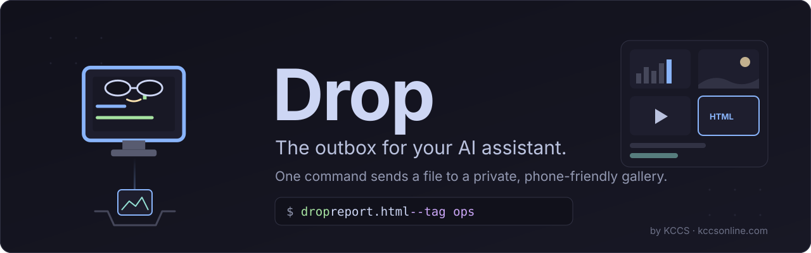
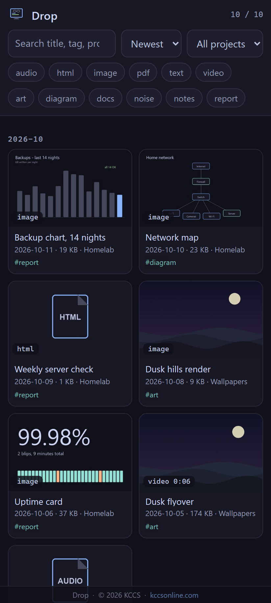
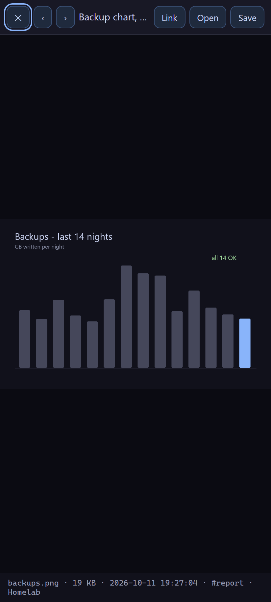
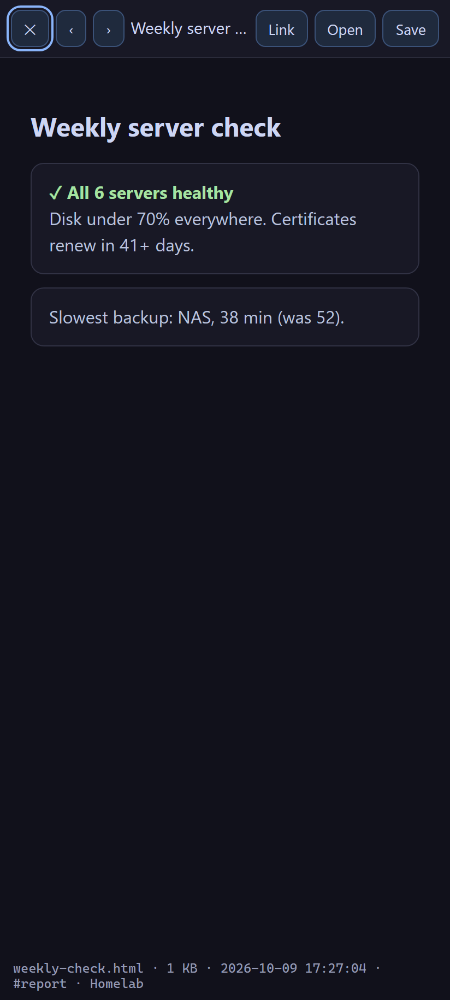
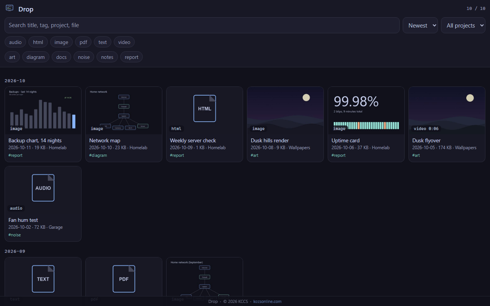
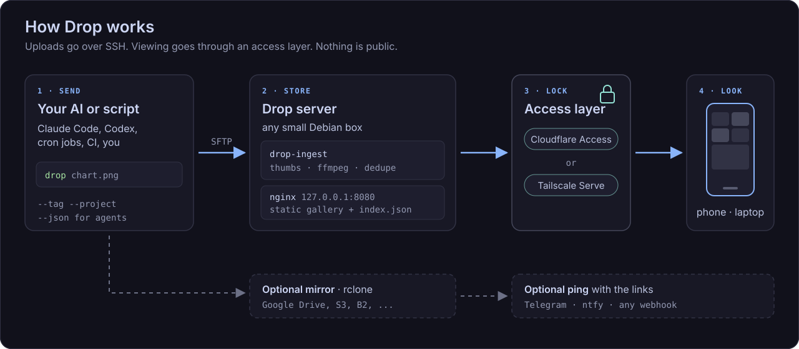

<div align="center">



**Your AI assistant made a chart, a video or a report. Drop puts it on your phone.**

[](https://github.com/pueblokc/drop/actions/workflows/ci.yml)


</div>

---

AI assistants are good at making things: charts, diagrams, rendered videos, HTML reports, exports.
They're bad at *showing* you those things. You get a file path in a chat window, on a computer
you're not sitting at.

**Drop fixes the last step.** The assistant (or any script) runs one command:

```bash
drop disk-report.html --title "Disk report" --tag ops
```

and you get a link to a private, dark, phone-friendly gallery where the file opens right away,
next to everything else it ever showed you, searchable by title, tag and project.

It's been the daily "here, look at this" channel between an AI assistant and its owner at
[KCCS](https://kccsonline.com) since September 2026: camera clips, network maps, render tests,
reports. This repo is that tool, cleaned up so anyone can run it.

## Screenshots

| Gallery | Image viewer | HTML report |
|:---:|:---:|:---:|
|  |  |  |



<sub>Screenshots use generated demo data (`python demo/make_demo.py --shots`).</sub>

## How it works



1. **Send.** The `drop` client uploads over SSH/SFTP. No HTTP upload endpoint exists.
2. **Store.** `drop-ingest` on the server makes a thumbnail (Pillow, ffmpeg), fixes MP4s for
   instant phone playback, dedupes by content hash and updates `index.json`.
3. **Lock.** nginx serves the static gallery on `127.0.0.1` only. You reach it through
   [Tailscale](docs/tailscale.md) or [Cloudflare Access](docs/cloudflare-access.md).
4. **Look.** Open the link on any device. Optionally, get pinged on Telegram, ntfy or a webhook.

## Features

- **One command** for files or whole folders, with `--title`, `--tag`, `--project`
- **Built for agents:** `--json` output, a meaningful exit code, `--dry-run`
- **Plays everything inline:** images, video (with seeking), audio, PDFs, HTML reports, text
- **Phone-first gallery:** search, type and tag filters, project picker, sort, month groups,
  deep links (`/#<id>`), viewer with prev/next and arrow keys
- **Dark by design:** Catppuccin Mocha on the darkest grounds, nothing big and bright
- **Never loses anything:** per-item `meta.json` is the source of truth, the index rebuilds from
  it, and `rm` moves to trash
- **Optional extras:** an rclone mirror (Google Drive, S3, B2...) and one notification per drop
- **Tiny footprint:** static files plus nginx. No database, no Node, no container required
- **Safe defaults:** loopback-only, sandboxed uploads, path and id validation. See [SECURITY.md](SECURITY.md)

## Quick start

### 1. Server (Debian or Ubuntu: a small VM, LXC or VPS)

```bash
git clone https://github.com/pueblokc/drop.git
cd drop/server
sudo DROP_TITLE="My Drops" ./install.sh
```

Then make a user for uploads and give it your SSH key:

```bash
sudo adduser --disabled-password --gecos "" drop
sudo chown -R drop: /srv/drop
sudo -u drop mkdir -p ~drop/.ssh && sudo -u drop tee -a ~drop/.ssh/authorized_keys < your_key.pub
```

### 2. Access layer (pick one)

- **[Tailscale](docs/tailscale.md):** `sudo tailscale serve --bg 8080`. Two minutes, tailnet only.
- **[Cloudflare Tunnel + Access](docs/cloudflare-access.md):** a real URL locked to your email.

> [!IMPORTANT]
> The gallery has no login of its own. It only listens on `127.0.0.1`, so it stays private
> until you add one of the layers above. Don't expose port 8080 directly.

### 3. Client (wherever your assistant or scripts run)

```bash
pip install "git+https://github.com/pueblokc/drop"
drop --init                       # writes ~/.config/drop/config.toml (Windows: %APPDATA%\drop\)
# edit gallery.url and [ssh], then:
drop --dry-run screenshot.png
drop screenshot.png --title "First drop"
```

```text
OK  2026-10-11_screenshot.png | https://drop.example.com/#3f89eea84c
```

## Use it with your AI assistant

Paste this into `CLAUDE.md`, `AGENTS.md` or your assistant's standing instructions:

```markdown
## Showing me things
When you make something I'd want to look at (image, video, report page, PDF, export),
send it to my Drop gallery and give me the link:

    drop <file-or-folder> --title "<short title>" --tag <topic> --project "<project>" --json

Use the `link` field from the JSON in your reply. Never drop secrets or other people's data.
```

More in [docs/ai-assistants.md](docs/ai-assistants.md).

## Reference

<details>
<summary><b><code>drop</code> client</b></summary>

```text
drop PATH [PATH ...] [--title T] [--tag X]... [--project P]
                     [--json] [--dry-run] [--no-notify] [--no-mirror] [--config FILE]
drop --init          write a starter config
drop --version
```

| Option | What it does |
|---|---|
| `--title` | Title shown in the gallery (default: file name) |
| `--tag` | Tag, repeatable. Tags become filter chips |
| `--project` | Groups items in the project picker |
| `--json` | Machine-readable result per file (`id`, `link`, `mirror`, `error`) |
| `--dry-run` | Show the plan, upload nothing |
| `--no-notify` / `--no-mirror` | Skip those extras for this run |

Exit code `0` means every file landed. Stored names get a date prefix (`2026-10-11_chart.png`).
Dotfiles and dot-folders are skipped when you drop a folder.
</details>

<details>
<summary><b>Client config</b> (<code>config.toml</code>)</summary>

See [`client/config.example.toml`](client/config.example.toml). Any secret can be written as
a literal, `env:VAR_NAME`, or `cmd:<command that prints it>` (handy for `pass`, `op read`,
`security find-generic-password` and so on).

| Section | Keys |
|---|---|
| `[gallery]` | `url`, `mode` (`ssh` or `local`) |
| `[ssh]` | `host`, `user`, `port`, `key`, `jump` (bastion), `host_keys` (`accept-new`/`strict`), `remote_inbox`, `ingest` |
| `[mirror]` | `rclone_remote` (e.g. `gdrive:Drops`), `public_link` |
| `[notify]` | `sender`, `telegram_token`, `telegram_chat`, `ntfy_url`, `webhook_url` |
</details>

<details>
<summary><b><code>drop-ingest</code> server tool</b></summary>

```text
drop-ingest add PATH [--name N] [--title T] [--tag X]... [--project P] [--move]
drop-ingest list
drop-ingest tag ID [--add X] [--remove Y] [--title T] [--project P]
drop-ingest rm ID           # moves to $DROP_ROOT/trash
drop-ingest reindex         # rebuild index.json from every meta.json
```

Layout under `$DROP_ROOT` (default `/srv/drop`):

```text
site/index.html        the gallery (static)
site/index.json        derived index
site/i/<id>/<file>     the original, plus thumb.jpg and meta.json
inbox/                 uploads land here first
trash/                 removed items
```

`/etc/default/drop` holds `DROP_ROOT` and `DROP_TITLE` for every run.
</details>

<details>
<summary><b>Troubleshooting</b></summary>

| Symptom | Fix |
|---|---|
| `cannot load SSH key` | Point `[ssh] key` at an unencrypted key, or load it into ssh-agent |
| `Server '...' not found in known_hosts` | You set `host_keys = "strict"`. SSH to the box once, or use `accept-new` |
| Video won't seek on a phone | Re-drop it: MP4/MOV get `+faststart` on ingest. Check ffmpeg is installed |
| Placeholder thumbnail for an image | Pillow couldn't read it (HEIC needs `pillow-heif` on the server). The file is still there |
| Gallery says *Could not load index.json* | Run `sudo drop-ingest reindex` on the server |
| HTML report can't load something | Reports run sandboxed. Inline everything (CSS, images as data URIs) |
</details>

## Roadmap

- Docker image for the server
- Upload from the phone's share sheet
- Optional expiring share links for one item

Ideas and pull requests are welcome. Please open an issue first for anything big.

## Credits

Built by [KCCS](https://kccsonline.com) in Pueblo, Colorado. Colors from
[Catppuccin](https://github.com/catppuccin/catppuccin) Mocha (MIT). Thumbnails by
[Pillow](https://python-pillow.org) and [FFmpeg](https://ffmpeg.org). SSH by
[Paramiko](https://www.paramiko.org).

Released under the [MIT License](LICENSE): free to use, change and share.

---

<div align="center">


**© 2026 KCCS · [kccsonline.com](https://kccsonline.com)**

</div>
